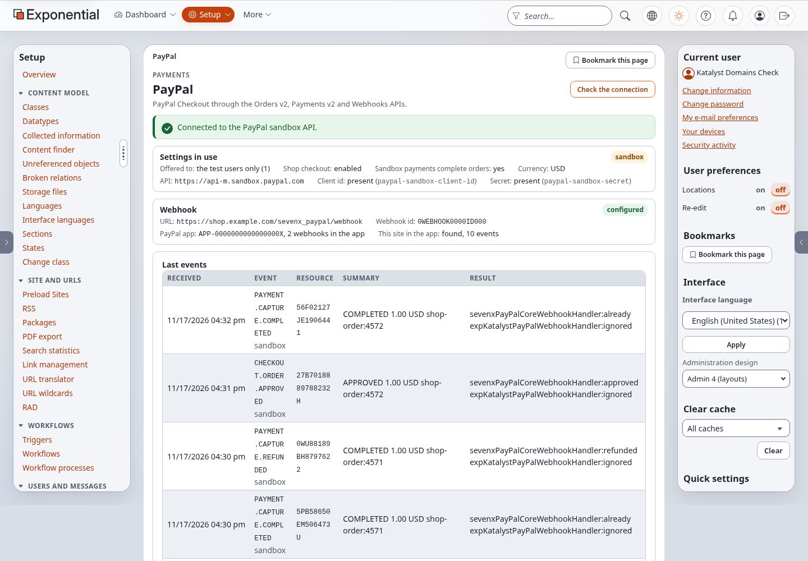

# Operations

## The status page

**Setup > PayPal** in the administration (`sevenx_paypal/status`, policy `sevenx_paypal/admin`):

- **Settings in use:** the mode (sandbox/live badge), who is offered PayPal, the shop checkout switch, whether sandbox
  payments complete orders, the currency, the API host, which credentials are present (by name, never a value);
- **Webhook:** the URL, the stored webhook id; after **Check the connection**: the app id, the number of webhooks in
  the app, whether this site's is there with all events and whether the stored id matches;
- **Create the webhook** (only when none is known): creates it in the mode's app and stores its id;
- **Last events:** time, type, resource, status and amount, the handlers' results ("not applied" when one failed);
- **Last payments:** PayPal order, what it pays, amount (and refunded), state, capture or hold id.



## Console

```bash
php extension/sevenx_paypal/bin/php/paypal.php --status [--mode=sandbox|live]
php extension/sevenx_paypal/bin/php/paypal.php --create-webhook [--mode=...] [--url=https://...]
php extension/sevenx_paypal/bin/php/paypal.php --install-schema
php extension/sevenx_paypal/bin/php/paypal.php --replay=WH-... [--mode=...]
```

Each ends with PASS or FAIL.

## Logs

`var/log/paypal.log` (`LogFile`): orders created, captured, refused (reason), refunds, voids, webhook refusals, failing
handlers, with PayPal's `debug_id` where PayPal sent one. Errors of the API also go to the kernel's debug log.

## Going live (checklist)

1. The sandbox checks of [testing.md](testing.md) pass (a capture, a refund, both webhooks verified).
2. The live REST app exists; its client id and secret are in the secret store (`paypal-live-client-id`,
   `paypal-live-secret` or your names).
3. `paypal.php --status --mode=live`: token ok.
4. `paypal.php --create-webhook --mode=live`: the live webhook exists, its id stored.
5. In `settings/override/paypal.ini.append.php`: `Mode=live`, `Enabled=enabled` (or `testers` with staff ids first),
   `AcceptSandboxPayments=disabled`, `ShopCheckout=enabled`.
6. Clear the INI cache (and a Redis/Valkey cache), reload PHP.
7. Setup > PayPal shows the live badge; **Check the connection**.
8. Watch the first real payments on the status page and in `paypal.log`.

Back to the sandbox: `Mode=sandbox` (and `Enabled=testers`), clear the INI cache. Late live deliveries are still
verified with the live webhook id.

## Monitoring

- The status page's last events: a growing number of "not applied" or 401s in the web server log mean trouble.
- PayPal's Developer Dashboard > Webhooks > Event history shows each delivery and its HTTP answer.
- Payments in state `PENDING` for more than a few days, or `MISMATCH`, need a look ([troubleshooting.md](troubleshooting.md)).

## Common errors and fixes

| Symptom | Fix |
| --- | --- |
| No buttons on the payment step | `ShopCheckout=enabled`, `Enabled` offers PayPal to this user, the credentials are present (status page), the template includes `shop_buttons.tpl`, clear the template caches |
| Buttons show, clicking gives "PayPal is not available here" (403) | the user is not offered PayPal (`TestUsers[]`, `EnabledSiteAccesses[]`) |
| "PayPal is not available right now" | the API refused or is unreachable: `paypal.php --status`, `paypal.log` |
| Webhooks 401 | webhook id missing or of another URL/app: `--status`, `--create-webhook` |
| Webhooks never arrive | the URL must be public https; the request shield or a WAF must let PayPal's POST through |
