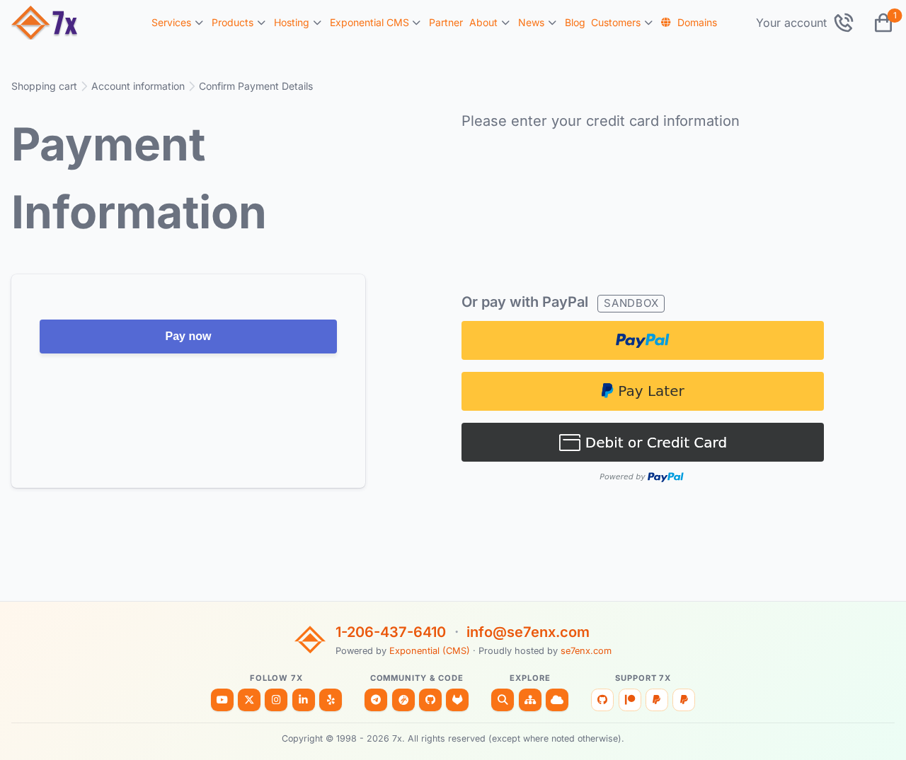

# Overview

sevenx_paypal adds PayPal as a payment method to an Exponential site. A buyer pays with the PayPal buttons that
PayPal's JavaScript SDK draws on the page: **PayPal** (the buyer's PayPal account), **Pay Later** and **Debit or
Credit Card** where PayPal offers them to the buyer's country and to your account. The money is taken by the
**server**, after the buyer approved, for an amount the server computed.

## What it does

- **Shop checkout.** The PayPal buttons appear on the shop's payment step next to the card gateway's form (Stripe,
  for example), which stays the default. A completed PayPal capture marks the order paid (status 1000), exactly what
  the card gateway does, so the kernel completes the order and every post-checkout integration runs unchanged. A shop
  that offers PayPal alone uses the payment gateway `Sevenx_PayPal`. See [checkout.md](checkout.md).
- **Buttons for any page.** `design:sevenx_paypal/buttons.tpl` and `javascript/sevenx_paypal_buttons.js` work with
  any pair of JSON routes that create and capture (or authorize) an order. Katalyst uses them for invoices, add
  funds, WHMCS invoices and domain orders ([katalyst.md](katalyst.md)).
- **Authorize, then capture.** An order can only hold the money (intent AUTHORIZE) and be captured later, or voided.
- **Refunds**, full or partial ([refunds.md](refunds.md)).
- **Webhooks.** The site's own webhook is created through the API; every delivery is verified, stored once and
  handled idempotently; other extensions add their own handlers ([webhooks.md](webhooks.md)).
- **Saved payment methods** (Vault v3): save during a checkout or on the buyer's page, charge later, remove
  ([vault.md](vault.md)).
- **Status page** in the administration (Setup > PayPal) and a console ([operations.md](operations.md)).
- **Mobile apps** get a PayPal order id for PayPal's own mobile SDK ([app-api.md](app-api.md)).

## The PayPal APIs it uses

| API | Calls | Used for |
| --- | --- | --- |
| OAuth 2.0 | `POST /v1/oauth2/token` (client credentials) | an access token per process, renewed before it expires |
| Orders v2 | `POST /v2/checkout/orders`, `GET /v2/checkout/orders/{id}`, `POST .../capture`, `POST .../authorize` | create the order, read it, take or hold the money after approval |
| Payments v2 | `GET /v2/payments/authorizations/{id}`, `POST .../capture`, `POST .../void`; `GET /v2/payments/captures/{id}`, `POST .../refund`; `GET /v2/payments/refunds/{id}` | holds, captures, refunds |
| Webhooks v1 | `GET`/`POST /v1/notifications/webhooks`, `POST /v1/notifications/verify-webhook-signature`, `GET /v1/notifications/webhooks-events/{id}` | create the site's webhook, verify deliveries, replay an event |
| JS SDK | `https://www.paypal.com/sdk/js?client-id=...` | the buttons in the browser |

| Vault v3 | `POST /v3/vault/setup-tokens`, `POST`/`GET`/`DELETE /v3/vault/payment-tokens`, `id_token` | saved PayPal accounts (and cards where PayPal allows it), charged later merchant-initiated ([vault.md](vault.md)) |

Every call that creates something carries a `PayPal-Request-Id`, so a repeated call gets PayPal's first answer back
instead of a second payment.

## Why not ezpaypal, IPN or NVP

The classic `ezpaypal` extension sends the buyer away to "Website Payments Standard" and learns the result from
**IPN** (Instant Payment Notification) messages; other integrations use the **NVP/SOAP** APIs (Express Checkout).
Those are PayPal's legacy products:

- they cannot show Pay Later or the card button where PayPal offers them, and they redirect the buyer away;
- IPN messages are verified by posting them back to PayPal, have no idempotency of their own and carry the payer's
  data in plain form fields;
- NVP/SOAP use API user names, passwords and signatures (or certificates) instead of OAuth client credentials;
- PayPal develops neither of them further.

sevenx_paypal uses only the current REST APIs listed above. It does not need, read or change the settings of
`ezpaypal`, and both can be installed at the same time.

## What it does not do

- It never sees or stores a card number: cards are typed into PayPal's own fields ([security.md](security.md)).
- It does not compute tax, coupons or shipping: it charges the total the shop (or the calling extension) computed.
- It does not change or delete webhooks of other systems that share the PayPal app.
