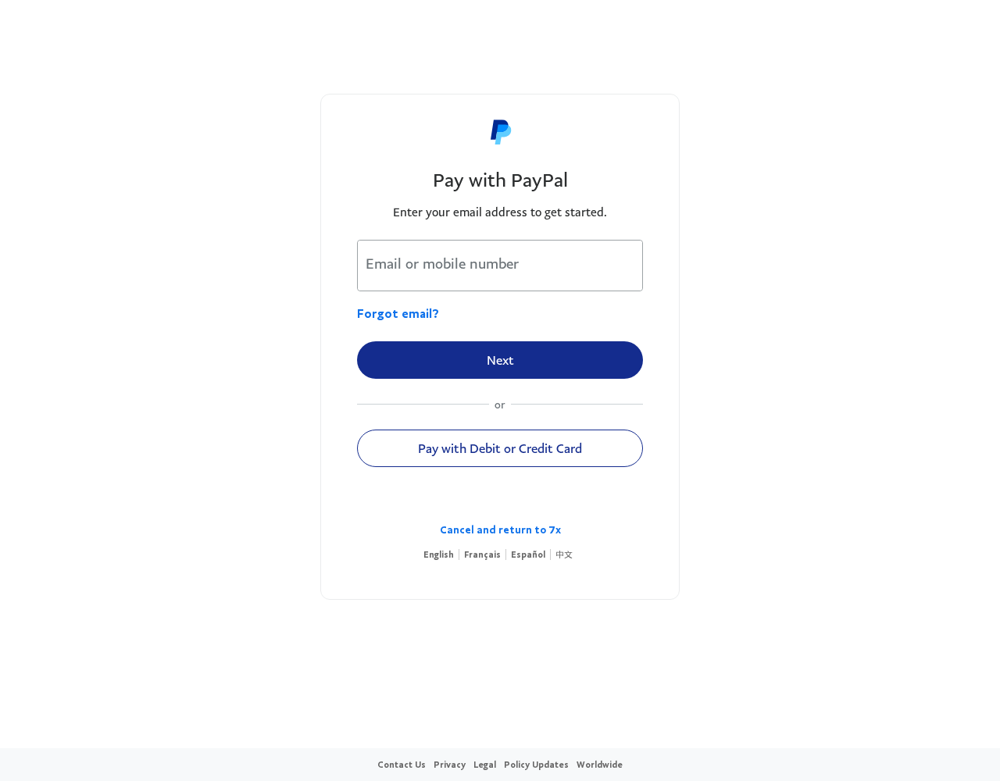

# PayPal account setup

Everything here is done twice: once in the **sandbox** (test money, test accounts) and once **live**. Start with the
sandbox and keep `Mode=sandbox` until the checks of [testing.md](testing.md) pass.

## 1. The REST app (credentials)

1. Sign in to <https://developer.paypal.com> with the PayPal Business account (live) of the shop.
2. **Apps & Credentials**. Switch between **Sandbox** and **Live** at the top.
3. **Create App**: a name (e.g. "Exponential shop"), type **Merchant**; in the sandbox pick the sandbox business
   account that receives the test payments.
4. Open the app: copy the **Client ID** and the **Secret** (Show).
5. Under the app's features keep **Accept payments** on. Pay Later and card payments need nothing else; **Vault**
   is not used yet.

An app can be shared with other software (a billing system, another shop). sevenx_paypal never changes or deletes
the webhooks of other URLs in it.

## 2. Store the credentials (never in an INI file)

In the administration: **Setup > Secrets**, add four entries (the names are the defaults; [PayPalSettings] can name
others):

| Name | Value |
| --- | --- |
| `paypal-sandbox-client-id` | the sandbox app's Client ID |
| `paypal-sandbox-secret` | the sandbox app's Secret |
| `paypal-live-client-id` | the live app's Client ID |
| `paypal-live-secret` | the live app's Secret |

The kernel encrypts them; pages and logs only ever show the names. Check with:

```bash
php extension/sevenx_paypal/bin/php/paypal.php --status --mode=sandbox
```

It answers `token: ok, app APP-...` and the app's webhooks.

## 3. Sandbox accounts (buyer and seller)

**Testing Tools > Sandbox Accounts** in the Developer Dashboard. PayPal creates one business and one personal account
for every developer; more can be created with **Create account**:

- **Business** (the seller): the sandbox app is linked to it; payments arrive there.
- **Personal** (a buyer): **Create account > Personal**, country United States; open **View/edit account** to see
  its e-mail address and to set its password. A buyer signs in with it on the sandbox approval page.

Without a personal account a buyer can use the sandbox's guest checkout ("Pay with Debit or Credit Card") with one
of PayPal's test cards (**Testing Tools > Card Testing**); `4012000033330026` (Visa) works in the guest form. The
end-to-end checks of [testing.md](testing.md) use that.



## 4. The webhook

Automatically (recommended), once per mode:

```bash
php extension/sevenx_paypal/bin/php/paypal.php --create-webhook --mode=sandbox
php extension/sevenx_paypal/bin/php/paypal.php --create-webhook --mode=live
```

or **Create the webhook** on Setup > PayPal (for the configured mode). It creates a webhook for
`https://<SiteURL>/sevenx_paypal/webhook` (or `[WebhookSettings] Url`) with the events below, unless the app has one for
that URL already, and stores its id in the secret store (`paypal-<mode>-webhook-id`). The id is not secret; it is
needed to verify deliveries.

Manually: in the app, **Webhooks > Add Webhook**, the URL above, the events below; then put the shown **Webhook ID**
into the secret store under `paypal-<mode>-webhook-id`, or into `[PayPalSettings] SandboxWebhookId` / `LiveWebhookId`.

Events:

| Event | What sevenx_paypal does |
| --- | --- |
| `CHECKOUT.ORDER.APPROVED` | the order is marked approved |
| `CHECKOUT.ORDER.COMPLETED` | recorded |
| `PAYMENT.CAPTURE.COMPLETED` | the capture is checked and applied (a shop order is marked paid if the page did not) |
| `PAYMENT.CAPTURE.PENDING` | the payment waits; nothing is delivered |
| `PAYMENT.CAPTURE.DENIED`, `PAYMENT.CAPTURE.DECLINED` | the payment failed; nothing is delivered |
| `PAYMENT.CAPTURE.REFUNDED`, `PAYMENT.CAPTURE.REVERSED` | the refunded amount is recorded |
| `PAYMENT.AUTHORIZATION.CREATED`, `PAYMENT.AUTHORIZATION.VOIDED` | the hold is recorded / released |

A PayPal app holds at most 10 webhooks.

## 5. Live

The same steps in the **Live** tab with the business account; then switch the site ([operations.md](operations.md)
"Going live").
