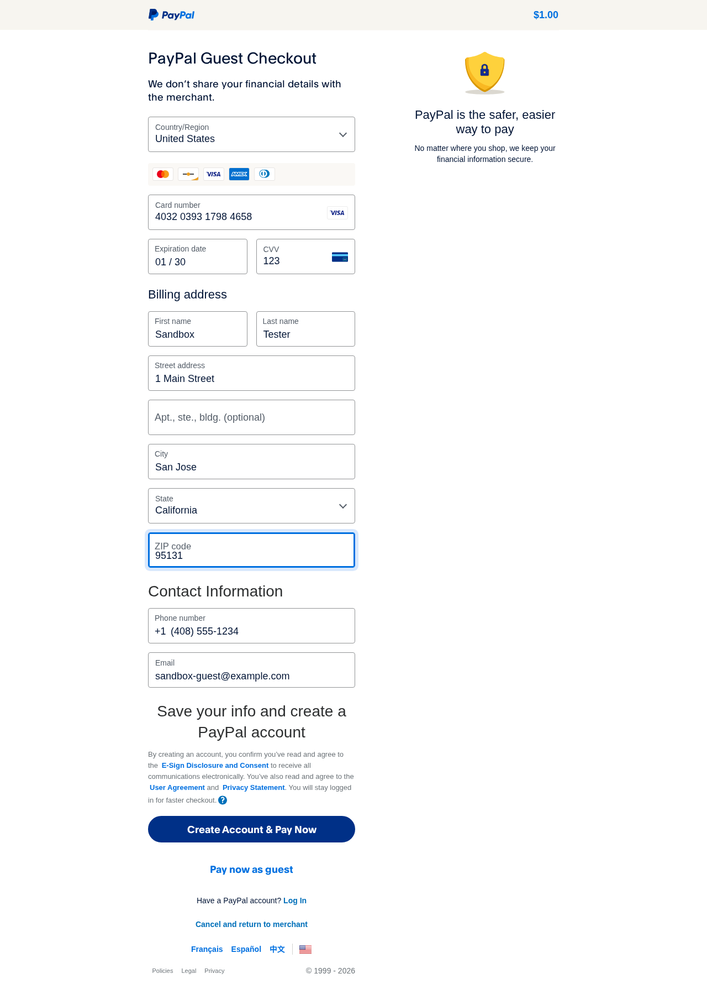

# Testing

## Unit tests (no database, no network)

From the Exponential root:

```bash
php vendor/bin/phpunit -c extension/sevenx_paypal/phpunit.xml.dist
```

| Test | Covers |
| --- | --- |
| `sevenxPayPalMoneyConfigTest` | minor units and PayPal's value strings (zero-decimal currencies, refused rounding), the credential checks, who is offered PayPal (testers, siteaccesses), the SDK URL carries public values only |
| `sevenxPayPalSignatureTest` | the delivery headers in any form, certificate hosts, the signed string, a recorded sample verified with PayPal's rule (`tests/fixtures/signature.json`: a throwaway key's certificate, no private key), changed body, webhook id, transmission and expired certificate refused, the API verification sends the body byte for byte |
| `sevenxPayPalPaymentsTest` | tokens cached and renewed after a 401, errors without card numbers, orders priced on the server and reused, captures checked and idempotent, mismatches, declines, pending, authorize/capture/void, a wrong hold voided, partial and full refunds never above the capture, payment sources |
| `sevenxPayPalWebhookTest` | refused and malformed deliveries store nothing, events stored once (replays are duplicates), no payer data kept, wrong amounts not paid, dashboard refunds followed, a failing handler makes PayPal deliver again, late deliveries never set a refund back |
| `sevenxPayPalDocsTest` | every setting of `settings/paypal.ini.append.php` is documented in `doc/configuration.md`, every link of the documentation resolves |

The tests use `tests/sevenxPayPalMockHttp.php`, a recording stand-in for PayPal's API.

## Sandbox end-to-end

Against PayPal's real sandbox, with `Mode=sandbox`, the credentials and the webhook in place:

1. **Connection:** `php extension/sevenx_paypal/bin/php/paypal.php --status --mode=sandbox`: a token, the app id, the
   site's webhook found with all events.
2. **A buyer's approval:** create an order with return URLs (`begin()` with `return_url`), open its approval link,
   sign in with a sandbox personal account or use **Pay with Debit or Credit Card** with test card
   `4012000033330026` and any future expiry and CVV, made-up test name and address ("Pay now as guest"). PayPal sends
   the browser back to the return URL.
   
3. **Capture:** `capture()` (or the shop's capture route): status `COMPLETED`, the order paid.
4. **Webhook:** within a minute `PAYMENT.CAPTURE.COMPLETED` is on the status page, verified, applied once.
5. **Refund:** `refund()` part of it, then the rest; `PAYMENT.CAPTURE.REFUNDED` arrives, verified, nothing recorded
   twice.
6. **Hold:** an AUTHORIZE order, `authorize()`, `captureAuthorization()`; another one `void()`ed.
7. **Cancel:** an order nobody approved: `capture()` refuses (`ORDER_NOT_APPROVED`), nothing is paid.

Server-side checks without a browser can give the order PayPal's sandbox test card as its payment source
(`begin( array( ..., 'payment_source' => array( 'card' => array( 'number' => '4032039317984658', 'expiry' => '2030-01' ) ) ) )`):
PayPal captures or authorizes at once, so steps 3 to 6 run unattended. This is refused in live mode.

## Live

Never pay in live mode to test. Check only that the live token works and the live webhook exists:

```bash
php extension/sevenx_paypal/bin/php/paypal.php --status --mode=live
```
